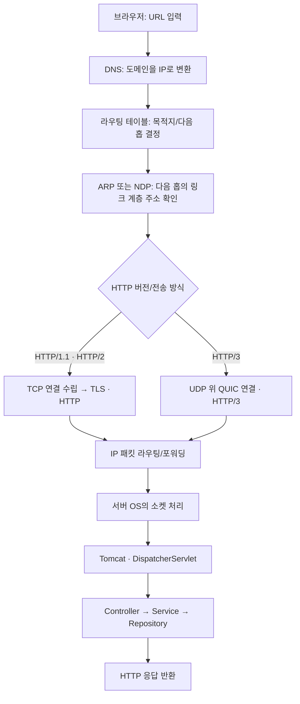
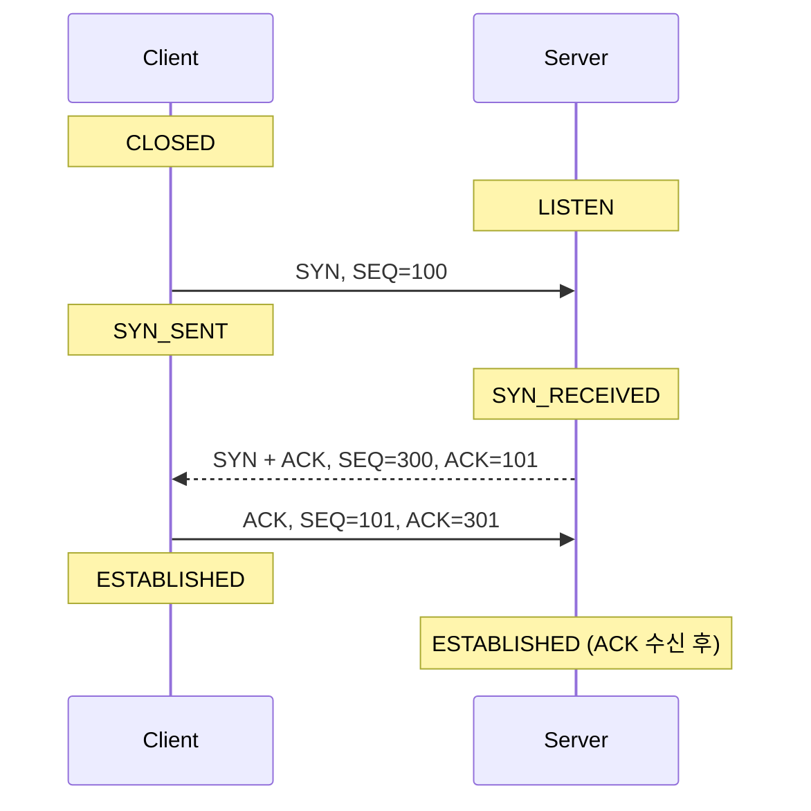
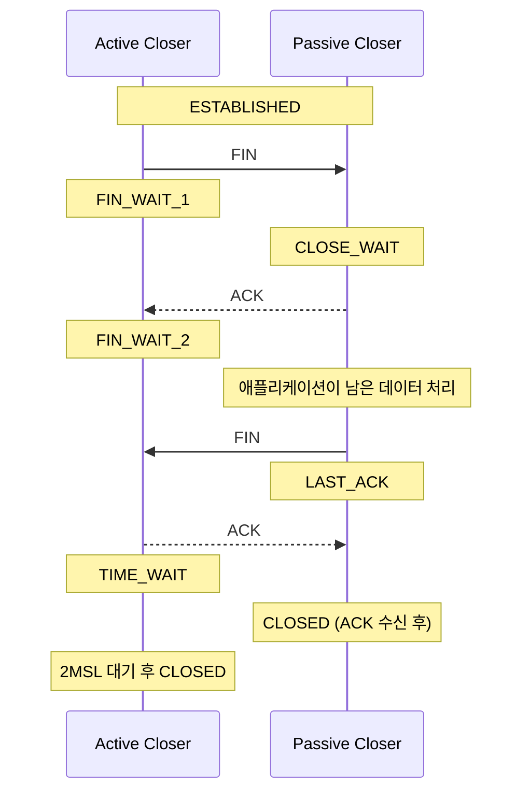
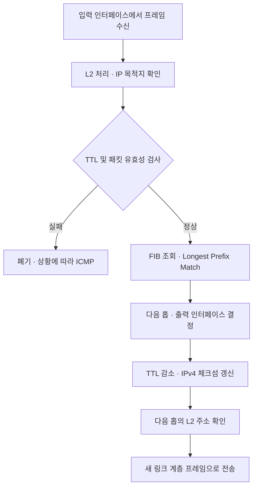
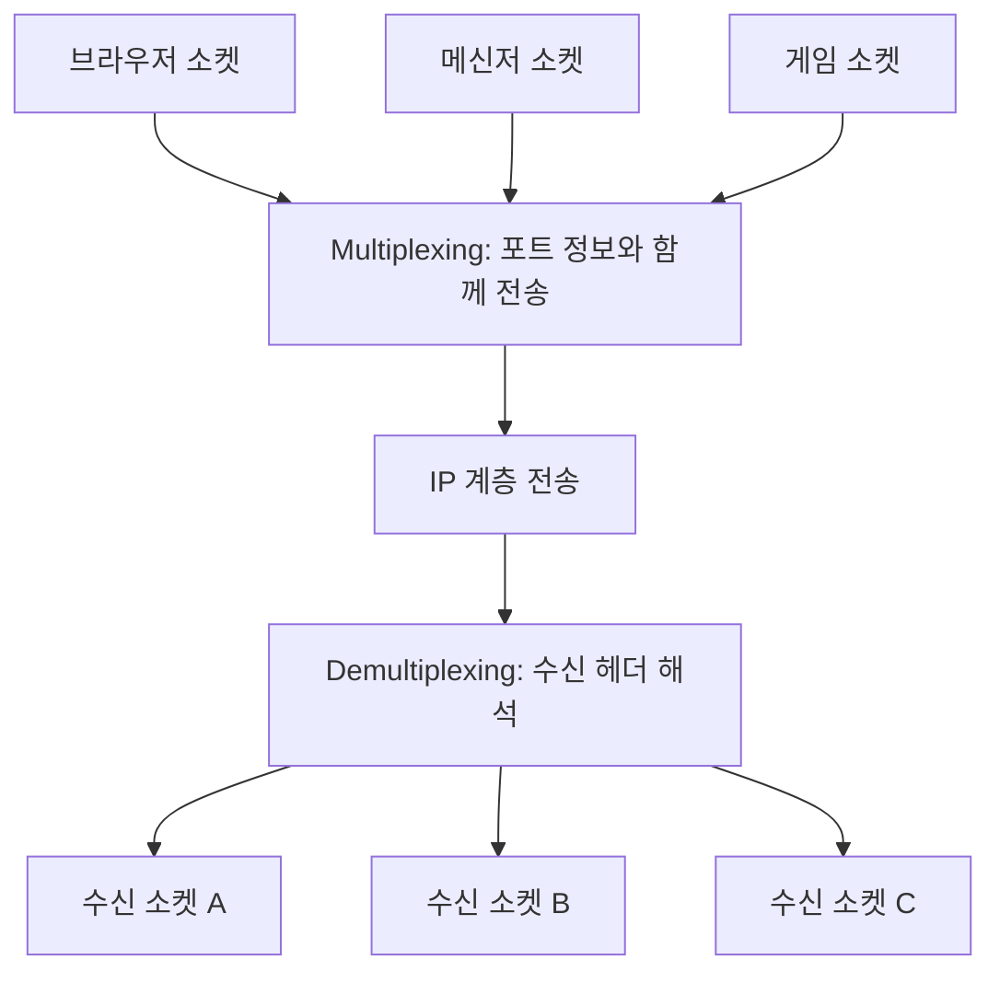
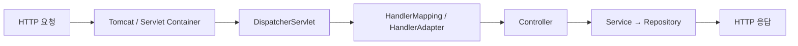

# Week 07 — Network II: 전송·네트워크 계층

> **TCP/UDP · OSI 7계층 · 3-Way/4-Way Handshake · 라우팅 · 서브넷 · 소켓**  
> **학습 방식:** 기술면접 1분 답변 → 상세 원리 → 꼬리 질문 → 백엔드 실무 적용 → 손코딩  
> 진행일: `____-__-__` (화) · 면접 질문 **9개** · 손코딩 **워밍업 1 + 응용 1문항**

[← Week 06](week-06.md) · [로드맵](../README.md) · [Week 08 →](week-08.md)

---

## 이번 주 목표

1. TCP와 UDP를 **신뢰성·순서·지연·전송 단위** 관점에서 비교한다.
2. TCP 연결 수립/종료를 **패킷 플래그와 상태 전이**로 설명한다.
3. **L3(IP) / L4(TCP·UDP) / L7(HTTP)** 역할과 캡슐화를 구분한다.
4. 라우팅, 포워딩, 서브넷, 기본 게이트웨이를 실제 패킷 경로에 적용한다.
5. Java/Spring 서버의 **연결 장애·지연·자원 누수** 문제에 네트워크 지식을 연결한다.
6. 최소 힙과 시간 기반 의사난수 추첨을 **IDE 없이 직접 구현**한다.

> **면접 답변 공식:** **정의(10초) → 원리/차이(20초) → 사례(15초) → 한계·주의점(10초)**  
> 아래 `면접용 답변`은 말하기 연습용이며, `상세 설명`은 꼬리 질문을 대비하기 위한 학습 노트다.

## 범위 한눈에 보기

| # | 질문 | 난이도 | 구분 |
|:--:|---|:--:|:--:|
| 1 | TCP와 UDP의 차이에 대해 설명해 주세요. | ★★☆ | 필수 |
| 2 | OSI 7계층에 대해 설명해 주세요. | ★★☆ | 필수 |
| 3 | 3-Way Handshake에 대해 설명해 주세요. | ★★☆ | 필수 |
| 4 | 4-Way Handshake에 대해 설명해 주세요. | ★★☆ | 필수 |
| 5 | 라우터 내의 포워딩 과정에 대해 설명해 주세요. | ★★★ | 심화 |
| 6 | 서브넷 마스크와 게이트웨이에 대해 설명해 주세요. | ★★☆ | 심화 |
| 7 | 멀티플렉싱과 디멀티플렉싱에 대해 설명해 주세요. | ★★☆ | 심화 |
| 8 | 프레임워크와 라이브러리의 차이에 대해 설명해 주세요. | ★☆☆ | 필수 |
| 9 | 순수함수를 함수형 프로그래밍 메커니즘과 연관지어 설명해 주세요. | ★★☆ | 심화 |

## 전체 연결 그림 — HTTP 요청은 어떻게 서버에 도달할까?



**계층의 핵심 구분**

- **IP(L3):** 목적지 호스트까지 패킷을 전달할 경로와 주소를 다룬다.
- **TCP/UDP(L4):** 포트 등을 사용해 호스트 내 프로세스 간 데이터 전달을 다룬다.
- **HTTP(L7):** 요청·응답의 구조와 의미를 정의한다.
- **주의:** TCP의 *전송 신뢰성*은 결제 API의 *정확히 한 번 실행*을 보장하지 않는다. 애플리케이션의 멱등성 처리는 별개다.

---

# Part 1. 네트워크

## 1. TCP와 UDP의 차이에 대해 설명해 주세요.

`★★☆` · `필수` · 원본 [네트워크 #7](../03-NETWORK.md)

### 면접용 답변 (약 1분)

> TCP와 UDP는 전송 계층의 프로토콜입니다. TCP는 **연결 지향적**이며 3-Way Handshake로 연결을 수립하고, 시퀀스 번호·ACK·재전송을 통해 **데이터의 순서와 신뢰성**을 제공합니다. 또한 흐름 제어와 혼잡 제어를 지원합니다. 반면 UDP는 **비연결형 데이터그램 프로토콜**로, TCP와 같은 전달 보장이나 순서 보장 기능을 자체 제공하지 않지만 구조가 단순하고 연결 수립 과정이 없습니다. 따라서 HTTP/1.1·HTTP/2나 데이터베이스 연결에는 TCP가 널리 사용되고, 실시간 음성·게임·QUIC 기반 HTTP/3 등에서는 UDP가 활용됩니다. **UDP가 무조건 빠른 것이 아니라 요구되는 지연·손실 허용·신뢰성 수준에 따라 선택해야 합니다.**

### 상세 설명

| 구분 | TCP | UDP |
|---|---|---|
| 연결 | 연결 지향 | 비연결형 |
| 데이터 모델 | **바이트 스트림**(메시지 경계 없음) | **데이터그램**(메시지 경계 있음) |
| 전달/순서 보장 | 순서 보장·손실 복구 | 기본 제공하지 않음 |
| 재전송 | ACK/타이머/손실 감지 기반 | 기본 제공하지 않음 |
| 흐름 제어 | 수신 윈도우(`rwnd`) | 자체 제공하지 않음 |
| 혼잡 제어 | 혼잡 윈도우(`cwnd`)·알고리즘 | 자체 제공하지 않음(상위 프로토콜에서 가능) |
| 최소 헤더 크기 | 20바이트(옵션 제외) | 8바이트 |
| 대표 예시 | HTTP/1.1, HTTP/2, DB 프로토콜 | DNS 질의, VoIP, 게임, QUIC |

**TCP 신뢰성의 핵심 메커니즘**

1. **시퀀스 번호(SEQ):** 데이터의 바이트 단위 위치를 추적한다.
2. **확인 응답(ACK):** 다음에 받아야 할 바이트 번호를 알린다.
3. **손실 복구:** 재전송 타이머(RTO), 중복 ACK, SACK 등을 활용한다.
4. **수신 버퍼:** 순서가 뒤바뀌어 도착한 데이터를 순서대로 애플리케이션에 제공한다.
5. **흐름 제어:** 수신자가 처리할 수 있는 양 이상으로 데이터를 밀어 넣지 않도록 한다.
6. **혼잡 제어:** 네트워크 전체에 과도한 트래픽이 유입되는 것을 억제한다.

예: 송신자가 `SEQ=1000`으로 500바이트를 보내고 정상 수신되었다면 상대방은 일반적으로 `ACK=1500`으로 다음 기대 바이트를 알린다.

```text
송신자                                  수신자
  | ---- SEQ=1000, 길이 500바이트 -----> |
  | <----------- ACK=1500 ------------- |
  | ---- SEQ=1500, 다음 데이터 --------> |
```

**중요한 함정 — TCP에는 메시지 경계가 없다.**

```java
// 클라이언트가 두 번 write()했다고 서버에서 두 번 read()되는 것은 아니다.
output.write("HELLO".getBytes(StandardCharsets.UTF_8));
output.write("WORLD".getBytes(StandardCharsets.UTF_8));
// 서버는 "HELLOWORLD"를 한 번에 받거나 여러 조각으로 받을 수 있다.
```

직접 TCP 기반 애플리케이션 프로토콜을 구현한다면 메시지 길이 프리픽스, 구분자, 고정 길이 레코드 등의 **프레이밍(Framing)**이 필요하다.

<details>
<summary><strong>꼬리 질문 9개 — 답변 펼치기</strong></summary>

1. **Checksum이 무엇인가요?**  
   헤더와 데이터 등을 이용해 계산한 검사값으로 전송 중 발생한 오류를 **검출**한다. 암호학적 무결성 보장이나 모든 오류 검출을 뜻하지는 않는다.

2. **TCP와 UDP 중 누가 Checksum을 수행하나요?**  
   둘 다 체크섬 필드가 있다. TCP 체크섬은 필수다. UDP는 **IPv4에서 체크섬 생략이 가능**하지만, **IPv6에서는 원칙적으로 필수**이며 일부 터널링 예외가 있다.

3. **Checksum으로 오류를 정정할 수 있나요?**  
   아니다. 오류가 감지되면 해당 데이터를 폐기하는 등의 처리를 하며, TCP는 ACK와 재전송으로 복구한다. 체크섬 자체가 원본 값을 복원하지는 않는다.

4. **TCP가 신뢰성을 보장하는 방법은?**  
   SEQ/ACK, RTO, 빠른 재전송, SACK, 수신 버퍼 및 재정렬을 설명한다. 단, 연결이 영구히 끊기면 항상 성공적으로 배달된다는 의미는 아니다.

5. **TCP 혼잡 제어는 어떻게 이루어지나요?**  
   전통적인 Reno에서는 Slow Start, Congestion Avoidance, Fast Retransmit/Recovery 등을 사용한다. 송신량은 대략 `min(cwnd, rwnd)`의 제약을 받는다. 실제 운영체제에서는 CUBIC·BBR 같은 방식도 사용한다. **흐름 제어는 수신자 보호, 혼잡 제어는 네트워크 보호**가 목적이다.

6. **HTTP는 왜 TCP를 사용하나요?**  
   HTTP/1.1·HTTP/2는 순서 있는 신뢰성 높은 바이트 전달을 TCP에 맡긴다. HTTP 자체가 언제나 TCP를 쓰는 것은 아니다.

7. **HTTP/3는 왜 UDP를 사용하나요? UDP의 문제가 해결됐나요?**  
   HTTP/3는 UDP 위의 **QUIC**을 사용한다. QUIC이 신뢰성, 손실 복구, 혼잡 제어, 스트림 멀티플렉싱, TLS 1.3 기반 보안을 구현한다. 따라서 **UDP 자체가 TCP처럼 바뀐 것이 아니라 QUIC이 필요한 기능을 구현**한 것이다. 스트림별 독립성으로 TCP 연결 수준의 Head-of-Line Blocking도 완화한다.

8. **브라우저는 서버가 TCP/UDP 중 무엇을 쓰는지 어떻게 알까요?**  
   HTTP `Alt-Svc` 헤더나 DNS **HTTPS(SVCB) 레코드** 등으로 HTTP/3 지원을 알 수 있다. 브라우저가 QUIC을 시도하고 실패 시 TCP 기반 HTTP로 폴백할 수 있다. 서버가 UDP 포트를 열었다는 사실만으로 HTTP/3가 자동 선택되는 것은 아니다.

9. **새로운 프로토콜을 만든다면 어떤 기준으로 선택하겠어요?**  
   신뢰성, 순서 보장, 메시지 경계, 손실 허용, 지연 요구, 재전송 비용, 방화벽/NAT 환경, 개발·운영 복잡도를 본다. 예: 결제·파일 전송에는 신뢰성 있는 전송이 중요하고, 실시간 좌표 스트리밍은 오래된 패킷보다 최신 패킷을 우선할 수 있다.

</details>

### 실무 연결 — Spring API의 네트워크 오류

| 현상 | 의미/점검 대상 |
|---|---|
| `Connection refused` | 서버 포트 미리스닝, 적극적인 연결 거부 등 |
| `Connect timeout` | SYN/SYN-ACK 등 연결 단계의 지연·실패, 네트워크/방화벽 |
| `Read timeout` | 연결 이후 응답 데이터 수신 지연, 서버·DB·네트워크 |
| `Connection reset` | RST로 연결이 끊어진 상황 |
| 데이터 파싱 실패 | TCP 성공 여부와 별개로 애플리케이션 프레이밍/직렬화 오류 가능 |

**실무 포인트:** 요청마다 새 TCP 연결을 수립하면 핸드셰이크 비용이 쌓인다. HTTP Keep-Alive와 클라이언트 커넥션 풀을 활용한다.

**핵심 키워드:** `SEQ` · `ACK` · `RTO` · `SACK` · `rwnd` · `cwnd` · `QUIC` · `Framing`

**내 답변:**

```text

```

**막힌 부분 / 다시 볼 것:**

- [ ]

---

## 2. OSI 7계층에 대해 설명해 주세요.

`★★☆` · `필수` · 원본 [네트워크 #10](../03-NETWORK.md)

### 면접용 답변 (약 1분)

> OSI 7계층은 네트워크 통신을 기능별로 나눈 **참조 모델**입니다. L1 물리 계층은 비트 신호, L2 데이터 링크는 같은 링크의 프레임 전달, L3 네트워크는 IP 주소와 경로 선택, L4 전송은 포트 및 종단 간 데이터 전달을 담당합니다. L5 세션은 통신 세션 관리, L6 표현은 데이터 표현·인코딩, L7 응용은 HTTP 같은 애플리케이션 통신 규칙을 다룹니다. 실제 인터넷에서는 **TCP/IP 모델**이 더 직접적으로 사용되며, 이러한 계층화는 장애 발생 시 어느 계층을 먼저 점검할지 판단하는 데 도움이 됩니다.

### 상세 설명

| 계층 | 기능 | 예시 | 대표 데이터 단위(PDU) |
|---|---|---|---|
| L7 응용 | 애플리케이션 통신 규칙 | HTTP, DNS, SMTP | Data/Message |
| L6 표현 | 데이터 표현·인코딩·변환 | UTF-8, JSON 표현, 암호화 관련 기능 | Data |
| L5 세션 | 대화·세션 관리 | 세션 관리 기능 | Data |
| L4 전송 | 프로세스 간 전달·포트 | TCP, UDP | Segment(TCP), Datagram(UDP) |
| L3 네트워크 | IP 주소·경로 선택 | IPv4, IPv6, ICMP | Packet |
| L2 데이터 링크 | 같은 링크에서의 프레임 전달 | Ethernet, Wi-Fi | Frame |
| L1 물리 | 신호·비트 전달 | 광섬유, 구리선, 전파 | Bit |

> **정확성 주의:** OSI 모델의 L5·L6을 현실의 독립 프로토콜로 반드시 1:1 대응시키지 않는다. TLS는 흔히 HTTP와 TCP 사이에서 동작하며, 운영 환경의 계층 경계는 OSI 표와 완전히 일치하지 않는다.

**캡슐화(Encapsulation)** — 데이터에 하위 계층의 제어 정보가 붙는다.

```text
HTTP Data
└─ TCP Header | HTTP Data
   └─ IP Header | TCP Header | HTTP Data
      └─ Ethernet Header | IP Header | TCP Header | HTTP Data | FCS
```

수신 측은 링크 계층부터 각 헤더를 처리해 상위 계층에 전달한다(역캡슐화). 이더넷 프레임은 다음 홉마다 새로 만들어질 수 있다.

<details>
<summary><strong>꼬리 질문 5개 — 답변 펼치기</strong></summary>

1. **Transport Layer와 Network Layer의 차이**  
   L3는 **목적지 호스트까지의 전달·경로**, L4는 **프로세스 간 데이터 전달**이다. IP가 호스트를, 포트가 통신 대상을 구별하는 데 사용된다.

2. **L3 Switch와 Router의 차이**  
   둘 다 IP 라우팅을 할 수 있다. 전통적으로 L3 스위치는 LAN/VLAN 간 고속 전달에, 라우터는 WAN 연결·다양한 경로 제어에 중점을 두었지만 현대 장비는 기능이 상당히 겹친다.

3. **각 계층의 PDU 명칭은?**  
   L7~5는 Data, L4는 TCP Segment/UDP Datagram, L3는 Packet, L2는 Frame, L1은 Bit라고 설명하면 된다.

4. **Header Packing Order(캡슐화 순서)는?**  
   바깥쪽부터 `Ethernet → IP → TCP → HTTP 데이터`. 송신할 때 상위 데이터에 하위 헤더가 추가되고 수신할 때 제거·해석된다. Ethernet FCS는 일반적인 트레일러다.

5. **ARP란?**  
   IPv4에서 같은 링크의 다음 홉 IP에 해당하는 **MAC 주소**를 알아낸다. 외부 목적지로 갈 때는 보통 목적지 서버가 아니라 **기본 게이트웨이의 MAC**을 찾는다. IPv6에서는 ICMPv6 Neighbor Discovery를 쓴다.

</details>

### 실무 연결 — HTTP 404와 TCP 장애는 다르다

| 증상 | 주로 확인할 영역 |
|---|---|
| 물리 링크 단절 | L1/L2 |
| 다른 네트워크로 연결 불가 | L3, 라우팅, ACL/방화벽 |
| 포트 연결 실패 | L4와 하위 계층 |
| TLS 인증서 검증 실패 | TLS 설정·신뢰 체인 |
| HTTP `404` | L7 경로·리소스·Controller 매핑 |
| HTTP `500` | 애플리케이션 내부 예외 및 서버 처리 |

**핵심 키워드:** `OSI` · `TCP/IP` · `Encapsulation` · `PDU` · `ARP` · `IP` · `Port`

**내 답변:**

```text

```

**막힌 부분 / 다시 볼 것:**

- [ ]

---

## 3. 3-Way Handshake에 대해 설명해 주세요.

`★★☆` · `필수` · 원본 [네트워크 #11](../03-NETWORK.md)

### 면접용 답변 (약 1분)

> 3-Way Handshake는 TCP에서 양쪽의 **연결 상태와 초기 시퀀스 번호를 동기화**하는 과정입니다. 클라이언트가 `SYN`을 보내면 서버는 `SYN+ACK`로 응답하고, 클라이언트가 마지막 `ACK`를 전송합니다. 서버가 마지막 ACK를 수신하면 양쪽의 연결이 수립됩니다. 이 과정은 상대방의 SYN에 대한 확인을 주고받아 연결 상태를 일치시키고 오래된 연결 요청의 혼동을 줄이는 데 필요합니다.

### 상세 설명 — 플래그와 TCP 상태



| 단계 | 보내는 측 | 주요 플래그 | 의미 |
|---|---|---|---|
| 1 | Client → Server | SYN | 연결 요청·클라이언트 ISN 전달 |
| 2 | Server → Client | SYN + ACK | 서버 ISN 전달·클라이언트 SYN 확인 |
| 3 | Client → Server | ACK | 서버 SYN 확인·연결 완료 |

`SYN`은 시퀀스 번호 공간에서 1을 소비하므로 `SEQ=100`으로 SYN을 전송했다면 상대방의 `ACK=101`이 된다. `FIN`도 번호 1을 소비한다.

**대표 TCP 플래그**

| 플래그 | 의미 |
|---|---|
| `SYN` | 연결 수립 및 시퀀스 동기화 |
| `ACK` | 확인 응답 필드가 유효함 |
| `FIN` | 해당 방향의 데이터 송신 종료 |
| `RST` | 연결 리셋 |
| `PSH` | 데이터를 지체 없이 상위 계층에 전달하도록 요청 |
| `URG` | 긴급 포인터 유효 |

<details>
<summary><strong>꼬리 질문 5개 — 답변 펼치기</strong></summary>

1. **ACK, SYN 같은 정보는 어떻게 전달되나요?**  
   TCP 헤더에 있는 **제어 플래그 비트**다. ACK를 실제로 확인하려면 ACK 플래그와 Acknowledgment Number 필드를 함께 본다.

2. **2-Way Handshaking을 사용하지 않는 이유는?**  
   서버가 자신의 `SYN`에 대한 클라이언트의 확인을 받지 못하므로 양방향 시퀀스 동기화가 불완전해진다. 지연된 과거 연결 요청으로 인한 혼동을 방지하는 측면에서도 세 번째 ACK가 중요하다.

3. **동시에 양쪽에서 연결을 시도해도 가능한가요?**  
   가능하다. TCP의 **Simultaneous Open**이다. 양쪽이 SYN_SENT에 있는 상황에서 서로의 SYN을 받고 SYN_RECEIVED를 거쳐 연결을 성립시킬 수 있다. 일반적인 웹 요청에서는 드문 방식이다.

4. **SYN Flooding이란?**  
   대량의 SYN으로 서버의 반쯤 열린 연결 자원 등을 소모시키는 DoS 공격이다. SYN Cookies, 요청률 제한, 네트워크 DDoS 방어 등의 대응이 있다.

5. **0-RTT는 어떻게 가능한가요?**  
   기존 연결 정보를 재사용하여 핸드셰이크 완료 전에 데이터를 보내는 방식이다. TCP Fast Open은 SYN에 데이터를 함께 실을 수 있고, QUIC 0-RTT는 이전 연결 정보를 활용해 초기 데이터를 전송한다. **0-RTT 데이터는 재생 공격(Replay Attack)에 주의**해야 한다. 0-RTT가 '어떤 경우에도 연결 수립 과정 전체가 사라진다'는 뜻은 아니다.

</details>

### 실무 연결 — 요청이 Controller에 도착하지 않는다

```bash
# 서버가 현재 어떤 TCP 포트를 LISTEN하는가? (Linux)
ss -lntp

# TCP 연결의 상태 확인
ss -tan

# 8080 포트에 도착하는 SYN·ACK·RST 등을 살펴보기 (권한 필요)
sudo tcpdump -nn -i any 'tcp port 8080'
```

- 서버 로그에 HTTP 요청이 전혀 없고 **connect timeout**이 발생했다면 TCP 연결/네트워크 경로 문제부터 점검한다.
- `Connection refused`이면 포트 리스닝·방화벽/장비의 적극적인 거부 등을 확인한다.
- 연결을 매 요청마다 새로 열면 TCP/TLS 핸드셰이크 비용이 발생하므로 **Keep-Alive·Connection Pool**을 활용한다.

**핵심 키워드:** `SYN` · `SYN-ACK` · `ACK` · `ISN` · `SYN_SENT` · `SYN_RECEIVED` · `ESTABLISHED` · `0-RTT`

**내 답변:**

```text

```

**막힌 부분 / 다시 볼 것:**

- [ ]

---

## 4. 4-Way Handshake에 대해 설명해 주세요.

`★★☆` · `필수` · 원본 [네트워크 #12](../03-NETWORK.md)

### 면접용 답변 (약 1분)

> 4-Way Handshake는 TCP 연결의 **정상 종료를 설명하는 대표적인 흐름**입니다. 한쪽이 `FIN`을 보내면 상대방이 `ACK`하고, 상대방이 남은 데이터 송신을 끝낸 후 `FIN`을 보냅니다. 최초 종료 요청 측은 마지막 `ACK`를 반환합니다. TCP는 양방향 데이터 흐름을 독립적으로 종료할 수 있기 때문에 FIN 교환이 별도로 필요할 수 있습니다. 마지막 ACK를 보낸 쪽은 보통 `TIME_WAIT` 상태를 거치며, 이는 **마지막 ACK의 재전송 대응**과 **지연된 과거 패킷의 혼입 방지**에 중요합니다.

### 상세 설명 — 종료 상태 전이



| 상태 | 의미 | 운영상 관찰 포인트 |
|---|---|---|
| `FIN_WAIT_1` | 내가 FIN 송신, 확인 대기 | 종료 절차 시작 |
| `FIN_WAIT_2` | 내 FIN은 ACK됨, 상대 FIN 대기 | 상대방의 송신 종료 대기 |
| `CLOSE_WAIT` | 상대 FIN 수신, 내 애플리케이션 종료 대기 | 과도하게 누적되면 소켓 반환 누락 의심 |
| `LAST_ACK` | 상대방에게 FIN 송신, 마지막 ACK 대기 | 정상 종료 마지막 단계 |
| `TIME_WAIT` | 마지막 ACK 후 지연 패킷 안전성 확보 | 짧은 연결이 많으면 다량 관찰 가능 |

**4-Way는 무조건 네 개 패킷이라는 뜻은 아니다.** ACK와 FIN이 하나의 패킷에 합쳐질 수도 있고, 양쪽이 동시에 FIN을 보낼 수도 있다. `close()`는 양방향 종료와 연결되지만 TCP는 `shutdown()` 등으로 **Half-Close**도 지원한다.

<details>
<summary><strong>꼬리 질문 4개 — 답변 펼치기</strong></summary>

1. **패킷이 종료 과정인지 어떻게 파악하나요?**  
   TCP 헤더의 `FIN` 또는 `RST`, 그리고 현재 소켓의 TCP 상태를 확인한다. `ACK`만으로 종료 패킷이라고 단정할 수 없다.

2. **빨리 끊어야 할 때는 어떻게 종료하나요?**  
   `RST`에 의한 **Abortive Close**가 가능하다. 정상 종료보다 데이터 손실 위험이 크며 전송·수신 중인 데이터의 처리를 보장하지 않는다.

3. **한쪽 네트워크가 갑자기 끊기면 반대쪽은 어떻게 인지하나요?**  
   물리적으로 단절되어도 즉시 알지 못할 수 있다. 송신 이후 재전송 시간 초과, TCP Keepalive, 애플리케이션 Heartbeat/Timeout 등의 기법으로 감지한다.

4. **TIME_WAIT가 필요한 이유는?**  
   마지막 ACK 손실로 상대방이 FIN을 다시 보낼 경우 재응답할 시간을 확보하고, 같은 연결 식별자를 재사용하는 새 연결에 이전 패킷이 섞이는 위험을 줄인다. TCP 규격상 2MSL이 핵심 개념이며 OS별 실제 구현은 다를 수 있다.

</details>

### 실무 연결 — CLOSE_WAIT와 자원 누수

```java
// 직접 소켓을 쓰는 경우: try-with-resources로 정상 반환
try (Socket socket = new Socket("example.com", 80)) {
    // 데이터 전송/수신
} catch (IOException e) {
    // 로깅 및 예외 처리
}
```

```bash
# TCP 상태별 연결 개수(Linux)
ss -tan | awk 'NR>1 {print $1}' | sort | uniq -c
```

- `CLOSE_WAIT` 누적 → 애플리케이션에서 소켓/응답 스트림 미종료 여부 확인.
- `TIME_WAIT` 다량 발생 → 무조건 장애가 아니라 단명 연결, 재사용 정책 등을 함께 조사.
- 상대방이 정상적으로 TCP를 닫았다는 사실과 **애플리케이션 비즈니스 트랜잭션 성공**은 별개다.

**핵심 키워드:** `FIN` · `RST` · `Half-Close` · `CLOSE_WAIT` · `FIN_WAIT_2` · `TIME_WAIT` · `2MSL`

**내 답변:**

```text

```

**막힌 부분 / 다시 볼 것:**

- [ ]

---

## 5. 라우터 내의 포워딩 과정에 대해 설명해 주세요.

`★★★` · `심화` · 원본 [네트워크 #17](../03-NETWORK.md)

### 면접용 답변 (약 1분)

> 포워딩은 라우터가 수신한 IP 패킷을 **적절한 출력 인터페이스와 다음 홉**으로 전달하는 동작입니다. 라우터는 목적지 IP를 확인한 후 포워딩 테이블(FIB)을 조회해 일반적으로 **Longest Prefix Match**로 가장 구체적인 경로를 선택합니다. IPv4 패킷의 TTL을 감소시키고 필요한 헤더 처리를 한 뒤 다음 홉의 링크 계층 주소를 사용하여 새 프레임으로 전송합니다. 반면 라우팅은 경로 정보를 계산·학습해 테이블을 구성하는 **Control Plane**, 포워딩은 개별 패킷을 전달하는 **Data Plane**의 역할이라는 차이가 있습니다.

### 상세 설명



> 이 순서는 개념 설명용이다. 실제 하드웨어에서는 일부 단계가 병렬화·최적화된다. IPv6는 IPv4와 달리 IP 헤더 체크섬이 없다.

**Longest Prefix Match 예시**

| 목적지 프리픽스 | Next Hop | Interface |
|---|---|---|
| `0.0.0.0/0` | `192.168.1.1` | eth0 |
| `10.0.0.0/8` | `192.168.2.1` | eth1 |
| `10.10.0.0/16` | `192.168.3.1` | eth2 |
| `10.10.20.0/24` | `192.168.4.1` | eth3 |

목적지가 `10.10.20.55`라면 네 경로가 모두 매칭될 수 있지만, 가장 구체적인 **`10.10.20.0/24`**가 선택된다. `8.8.8.8`은 기본 경로 `0.0.0.0/0`이 사용된다(다른 정책이 없을 때).

**라우터 통과 시 주소의 변화**

- **L2 출발지/목적지 MAC:** 홉마다 바뀔 수 있다.
- **L3 출발지/목적지 IP:** NAT, 터널링 등 별도 처리가 없다면 보통 유지된다.
- **IPv4 TTL / IPv6 Hop Limit:** 라우터를 지날 때 감소한다.

<details>
<summary><strong>꼬리 질문 3개 — 답변 펼치기</strong></summary>

1. **라우팅과 포워딩의 차이는?**  
   **라우팅:** 경로 정보를 학습·계산·선택하여 라우팅 테이블을 만든다(Control Plane). **포워딩:** 이미 정해진 테이블을 사용해 실제 패킷을 보낸다(Data Plane). 라우팅 정보(RIB)와 실제 포워딩 정보(FIB)는 역할상 구분된다.

2. **라우팅 알고리즘에는 무엇이 있나요?**  
   **Distance Vector:** 이웃으로부터 경로/비용 정보를 교환(RIP 등). **Link State:** 링크 상태를 공유해 최단 경로 계산(OSPF, Dijkstra). **Path Vector:** 경로 속성/정책을 활용(BGP). BGP를 단순 최단 홉 알고리즘으로 설명하면 부정확하다.

3. **포워딩 테이블은 어떤 구조인가요?**  
   대상 네트워크 프리픽스, 다음 홉, 출력 인터페이스, 전달 동작 등으로 구성되며, 빠른 프리픽스 매칭을 위해 Trie, TCAM 등의 구조가 사용될 수 있다.

</details>

### 실무 연결 — 클라우드 VPC와 네트워크 경로

```bash
# Linux 라우팅 테이블
ip route

# 특정 목적지에 대한 커널 경로 선택
ip route get 8.8.8.8

# 중간 홉 확인(traceroute 설치 필요)
traceroute 8.8.8.8
```

AWS VPC에서 EC2가 인터넷에 접속하지 못할 때는 **서브넷 라우팅 테이블 → 인터넷 게이트웨이/NAT 게이트웨이 → 보안 그룹/네트워크 ACL** 등을 순서대로 확인한다. 단, 외부로 나가는 경로와 외부에서 들어오는 경로는 요구 조건이 다르다.

**핵심 키워드:** `RIB` · `FIB` · `Control Plane` · `Data Plane` · `Longest Prefix Match` · `Next Hop` · `TTL`

**내 답변:**

```text

```

**막힌 부분 / 다시 볼 것:**

- [ ]

---

## 6. 서브넷 마스크와 게이트웨이에 대해 설명해 주세요.

`★★☆` · `심화` · 원본 [네트워크 #19](../03-NETWORK.md)

### 면접용 답변 (약 1분)

> 서브넷 마스크는 IP 주소의 **네트워크 부분과 호스트 부분을 구분**하는 값입니다. IP와 서브넷 마스크를 비트 AND 연산하면 네트워크 주소를 구할 수 있습니다. 게이트웨이는 다른 네트워크로 패킷을 보낼 때 거치는 다음 홉이며 일반적으로 라우터가 역할을 합니다. 호스트는 라우팅 테이블을 보고 목적지로 직접 전송할지, 기본 게이트웨이로 보낼지를 결정합니다. 주소 공간 분할에는 `/24`, `/26`처럼 **CIDR 프리픽스** 표현을 사용합니다.

### 상세 설명 — 서브넷 계산

예: **`192.168.10.42/26`**

```text
IPv4 주소       192.168.10.42
서브넷 마스크   255.255.255.192
CIDR            /26  (네트워크 26비트, 호스트 6비트)

마지막 옥텟의 비트 AND:
IP   42   = 00101010
Mask 192  = 11000000
            --------
AND         = 00000000

네트워크 주소     192.168.10.0
브로드캐스트      192.168.10.63
호스트 범위       192.168.10.1 ~ 192.168.10.62
전체 주소 수      2^(32-26) = 64
일반적인 호스트 수 64-2 = 62
```

`/26` 서브넷의 네트워크 경계는 마지막 옥텟에서 **0, 64, 128, 192**다.

| CIDR | 마스크 | 주소 수 | 일반적인 호스트 수 |
|---|---|---:|---:|
| `/24` | `255.255.255.0` | 256 | 254 |
| `/25` | `255.255.255.128` | 128 | 126 |
| `/26` | `255.255.255.192` | 64 | 62 |
| `/27` | `255.255.255.224` | 32 | 30 |
| `/28` | `255.255.255.240` | 16 | 14 |

> 표의 호스트 수는 일반적인 IPv4 브로드캐스트 서브넷(`/30` 이하의 일반 범위 등)을 가정한다. `/31`, `/32` 및 클라우드 서비스의 예약 주소는 별도 규칙이 있다.

**기본 게이트웨이 예시**

```text
내 PC IP: 192.168.10.42/26, Gateway: 192.168.10.1

목적지 192.168.10.50 → 같은 서브넷 → 링크에서 직접 전송
목적지 192.168.10.70 → 다른 서브넷 → 라우팅 테이블에 따라 Gateway 경유
```

호스트는 **ARP로 같은 링크의 다음 홉 MAC 주소**를 알아낸 뒤 프레임을 만든다. 외부 서버의 MAC을 직접 알아내려고 하는 것이 아니다.

<details>
<summary><strong>꼬리 질문 3개 — 답변 펼치기</strong></summary>

1. **NAT란?**  
   Network Address Translation은 패킷의 IP 주소를 변환한다. 가정용 공유기의 다수 내부 장치가 하나의 공인 IPv4 주소를 공유할 때는 흔히 **NAPT/PAT**로 주소와 포트를 함께 변환한다. NAT 테이블이 응답을 올바른 내부 장치로 전달할 수 있도록 매핑을 관리한다.

2. **서브넷 마스크 표현 방식은?**  
   `255.255.255.0` 같은 점으로 구분한 10진수 표현과 `/24` 같은 CIDR 표현이 있다. `/24`는 왼쪽부터 네트워크 비트 24개가 `1`이라는 뜻이다.

3. **`255.0.255.0`도 가능한가요?**  
   일반적인 CIDR 서브넷 마스크로는 **불가능**하다. 마스크의 `1` 비트는 왼쪽부터 연속되어야 한다. `11111111.00000000.11111111.00000000`은 중간에 `0`이 나온 뒤 다시 `1`이 나타난다.

</details>

### 실무 연결 — AWS 서브넷 주소 예약

AWS VPC IPv4 서브넷은 **첫 4개와 마지막 1개** 주소를 예약한다. 따라서 `/24` 서브넷의 전체 주소 256개 중 일반적인 인스턴스용으로 사용할 수 있는 주소는 **251개**다. 사설망 설계에서 OS 일반 계산과 클라우드 예약 정책을 구분한다.

**핵심 키워드:** `CIDR` · `Network/Broadcast` · `Subnetting` · `Default Gateway` · `ARP` · `NAT/NAPT`

**내 답변:**

```text

```

**막힌 부분 / 다시 볼 것:**

- [ ]

---

## 7. 멀티플렉싱과 디멀티플렉싱에 대해 설명해 주세요.

`★★☆` · `심화` · 원본 [네트워크 #20](../03-NETWORK.md)

### 면접용 답변 (약 1분)

> 전송 계층의 멀티플렉싱은 여러 애플리케이션 소켓에서 나온 데이터를 포트 등의 정보를 붙여 하위 네트워크 계층으로 보내는 과정입니다. 반대로 디멀티플렉싱은 수신 패킷의 전송 계층 헤더를 읽어 적절한 소켓으로 전달하는 과정입니다. TCP의 확립된 연결은 **출발지 IP·포트와 목적지 IP·포트의 4-Tuple**로 구별되므로 하나의 서버 포트에 여러 클라이언트가 동시에 접속할 수 있습니다. UDP의 소켓 전달은 주로 목적지 주소·포트와 바인딩 상태를 기반으로 이루어집니다.

### 상세 설명



**TCP 4-Tuple 예시**

```text
Client A 10.0.0.10:51000 → Server 10.0.0.5:8080
Client B 10.0.0.11:52000 → Server 10.0.0.5:8080

목적지 포트는 동일하지만 출발지 IP/Port가 다르므로 서로 다른 TCP 연결.
```

- **서버 리스닝 소켓:** `:8080` 같은 포트에 연결 요청을 받는다.
- **확립된 연결 소켓:** 각 클라이언트에 대응하는 연결 식별자(4-Tuple 등)를 갖는다.
- **UDP:** 메시지 경계를 유지하지만 기본적으로 TCP 연결 상태가 없다. 바인딩 방식과 연결된 UDP 소켓 여부에 따라 출발지 주소 필터링을 사용할 수 있다.

<details>
<summary><strong>꼬리 질문 1개 — 답변 펼치기</strong></summary>

1. **디멀티플렉싱은 어떤 순서로 작동하나요?**  
   (1) IP 헤더의 프로토콜 정보를 확인한다. (2) TCP/UDP 헤더에서 포트 및 필요한 연결 정보를 추출한다. (3) 운영체제가 소켓 테이블 등을 조회한다. (4) 일치하는 소켓의 수신 큐에 데이터를 전달한다. (5) 애플리케이션이 `read()`/`recv()` 등으로 읽는다.

</details>

### 실무 연결 — HTTP/2/3의 멀티플렉싱과는 구분

| 구분 | 멀티플렉싱의 단위 | 설명 |
|---|---|---|
| 전송 계층 | 소켓/포트 | 여러 애플리케이션 데이터를 전송·분배 |
| HTTP/2 | HTTP 스트림 | **하나의 TCP 연결**에서 여러 요청/응답 스트림 처리 |
| HTTP/3 | QUIC 스트림 | 하나의 QUIC 연결에서 독립 스트림 처리 |

HTTP/2에서는 TCP 패킷 손실로 인해 **같은 TCP 연결의 다른 스트림**도 전달 지연 영향을 받을 수 있다. HTTP/3는 QUIC 스트림의 독립적인 손실 복구로 이 문제를 완화한다.

**핵심 키워드:** `Multiplexing` · `Demultiplexing` · `Port` · `Socket` · `4-Tuple` · `HTTP/2` · `QUIC Stream`

**내 답변:**

```text

```

**막힌 부분 / 다시 볼 것:**

- [ ]

---

# Part 2. 개발상식 코너

## 8. 프레임워크와 라이브러리의 차이에 대해 설명해 주세요.

`★☆☆` · `필수` · 원본 [개발상식·기타 #6](../05-ETC.md)

### 면접용 답변 (약 1분)

> 라이브러리는 개발자가 필요한 시점에 직접 호출해서 사용하는 기능의 집합입니다. 반면 프레임워크는 프로그램의 구조와 실행 흐름을 제공하고, 개발자가 작성한 코드를 정해진 위치에서 호출합니다. 핵심은 **제어권의 주체**에 있습니다. 프레임워크가 전체 흐름을 제어하는 구조는 **제어의 역전(IoC)**과 관련이 있습니다. 예를 들어 Jackson은 직접 객체 직렬화에 활용할 수 있는 라이브러리이고, Spring MVC는 HTTP 요청을 받아 적절한 Controller를 호출하는 프레임워크입니다.

### 상세 설명

| 구분 | 라이브러리 | 프레임워크 |
|---|---|---|
| 주도권 | 주로 개발자 코드 | 주로 프레임워크 |
| 사용 방식 | 필요한 함수/클래스를 호출 | 확장 지점에 코드 등록, 프레임워크가 호출 |
| 예시 | Jackson, Apache Commons | Spring MVC, Django |
| 핵심 개념 | 기능 재사용 | 구조·생명주기·제어권 |

```java
// 라이브러리: 개발자가 직접 호출
ObjectMapper mapper = new ObjectMapper();
String json = mapper.writeValueAsString(user);
```

```java
// 프레임워크: Spring MVC가 해당 핸들러를 찾아 호출
@RestController
@RequestMapping("/users")
public class UserController {

    @GetMapping("/{id}")
    public String getUser(@PathVariable Long id) {
        return "user " + id;
    }
}
```

**일반적인 Spring MVC 요청 흐름**



**IoC와 DI의 차이**

- **IoC(Inversion of Control):** 객체 생성·호출·실행 흐름의 일부 제어권이 외부 컨테이너로 이동하는 설계 원칙.
- **DI(Dependency Injection):** 외부에서 의존 객체를 제공하는 구현 방식. IoC의 대표적 수단 중 하나.

```java
@Service
public class OrderService {
    private final OrderRepository repository;

    public OrderService(OrderRepository repository) {
        this.repository = repository;
    }
}
```

> 주의: 라이브러리도 콜백을 호출할 수 있고 프레임워크 내부에서도 라이브러리를 직접 사용한다. 분류 경계가 언제나 절대적인 것은 아니다.

### 실무 연결

Spring Controller 매핑 오류, 빈 생성/주입 실패, 필터·인터셉터 순서, 트랜잭션 AOP 동작을 이해하려면 **프레임워크가 언제 내 코드를 호출하는지** 알아야 한다.

**지정 꼬리 질문 없음 — 스스로 정할 질문:** `IoC와 DI의 차이는?` / `DispatcherServlet은 무슨 역할을 하는가?`

**핵심 키워드:** `IoC` · `DI` · `Container` · `DispatcherServlet` · `Callback`

**내 답변:**

```text

```

**막힌 부분 / 다시 볼 것:**

- [ ]

---

## 9. 순수함수를 함수형 프로그래밍 메커니즘과 연관지어 설명해 주세요.

`★★☆` · `심화` · 원본 [개발상식·기타 #8](../05-ETC.md)

### 면접용 답변 (약 1분)

> 순수함수는 **동일한 입력에 항상 같은 결과**를 반환하고, 외부 상태를 변경하거나 관찰 가능한 부작용을 발생시키지 않는 함수입니다. 함수형 프로그래밍은 순수함수, 불변성, 고차함수, 함수 합성 등을 활용해 프로그램을 구성합니다. 순수함수는 외부 가변 상태에 의존하지 않기 때문에 테스트와 추론이 쉬우며 공유 상태 변경으로 발생하는 동시성 문제를 줄일 수 있습니다. 실제 백엔드에서는 계산·변환 같은 핵심 로직을 가능한 순수하게 작성하고 DB 저장·API 호출 같은 부작용은 명확한 경계에서 처리하는 방식으로 적용합니다.

### 상세 설명

**순수함수의 조건**

1. **결정성:** 같은 입력 → 같은 결과.
2. **부작용 없음:** 외부 변수 수정, 파일 쓰기, DB 변경 등 외부에서 관찰 가능한 상태 변화를 일으키지 않음.

```java
// 순수한 계산
public int calculateTotal(int price, int quantity) {
    return price * quantity;
}

// 순수하지 않음: 외부 가변 상태 의존
private int discount = 1000;
public int discounted(int price) {
    return price - discount;
}

// 순수하지 않음: 외부 부작용
public int logAndReturn(int value) {
    System.out.println(value);
    return value;
}
```

| 개념 | 설명 |
|---|---|
| 순수함수 | 동일 입력/동일 출력, 외부 부작용 없음 |
| 불변성 | 기존 객체/상태를 수정하지 않고 새 값 생성 |
| 참조 투명성 | 함수 호출을 결과값으로 대체해도 의미가 유지됨 |
| 고차함수 | 함수를 인자로 받거나 반환하는 함수 |
| 함수 합성 | 여러 함수를 조합해 하나의 처리 과정 구성 |

**Java Stream 예시**

```java
List<Integer> doubled = List.of(1, 2, 3, 4)
        .stream()
        .map(x -> x * 2)
        .toList();
```

`map`은 함수를 인자로 받는 고차 연산이고 `x -> x * 2`는 순수한 변환이다. 스트림 내부에서 공유 리스트나 카운터를 변경하면 병렬 실행 시 문제가 생길 수 있다.

<details>
<summary><strong>꼬리 질문 4개 — 답변 펼치기</strong></summary>

1. **Side Effect는 무엇인가요? 모두 없애야 하나요?**  
   함수 반환값 이외에 외부 상태를 읽고 변경하거나 외부 세계에 영향을 주는 동작을 말한다(정확히는 외부 상태 읽기 자체는 결과의 결정성을 깨는 비순수성으로 구분할 수 있다). DB 저장, 파일 쓰기, 네트워크 호출, 콘솔 출력 등이 대표 사례다. 실제 서비스에서는 부작용이 필요하므로 **순수 계산과 I/O를 분리해 관리**하는 것이 현실적이다.

2. **함수형 프로그래밍을 사용하는 이유는?**  
   추론·테스트가 쉽고 불변성을 통해 공유 상태 경쟁을 줄이며, 작은 함수 조합으로 데이터 처리 파이프라인을 만들기 위해서다. 모든 문제에 항상 최적인 것은 아니다.

3. **순수함수는 Thread Safe 한가요?**  
   외부 공유 가변 상태를 읽거나 수정하지 않는 순수 계산은 호출 간 간섭이 없으므로 동시 실행에 안전하다. 단, 전달받은 가변 객체가 다른 스레드에서 바뀐다면 순수성 조건부터 깨질 수 있다. **불변 객체와 안전한 입력 관리**가 중요하다.

4. **고차함수란 무엇인가요?**  
   함수를 인자로 받거나 반환하는 함수다. Java의 `Stream.map()`, `filter()`, `Function<T,R>`, `Predicate<T>` 등을 예로 들 수 있다.

</details>

### 실무 연결 — 비즈니스 로직과 I/O 분리

```java
// 순수 계산: 단위 테스트에서 DB/Mock이 불필요
public BigDecimal calculateTotal(BigDecimal unitPrice, int quantity) {
    return unitPrice.multiply(BigDecimal.valueOf(quantity));
}

// 부작용 있는 영역: 영속성 저장 및 트랜잭션 처리
@Transactional
public void saveOrder(Order order) {
    orderRepository.save(order);
}
```

**핵심 키워드:** `Pure Function` · `Side Effect` · `Immutability` · `Referential Transparency` · `Higher-Order Function` · `Thread Safety`

**내 답변:**

```text

```

**막힌 부분 / 다시 볼 것:**

- [ ]

---

# Part 3. 손코딩 (Java)

## 워밍업 — 자료구조 [4/6] 최소 힙(Min Heap)

> 원본 [손코딩 #1·#2](../06-ALGORITHM.md) · 목표 **10분 이내, IDE 자동완성 없이 구현**

### 개념

- **최소 힙:** 부모의 값이 자식보다 작거나 같은 완전 이진 트리.
- **배열 인덱스(0부터 시작):** 부모 `(i-1)/2`, 왼쪽 자식 `2*i+1`, 오른쪽 자식 `2*i+2`.
- `push`: 맨 뒤에 추가 → 부모와 비교하며 **sift-up**.
- `pop`: 루트 제거 → 마지막 원소를 루트에 놓고 **sift-down**.
- `peek`: 루트를 그대로 확인.

```text
           1 (index 0)
          / \
     3 (1)   5 (2)
    /  \     /  \
   7    4   8    9

배열: [1, 3, 5, 7, 4, 8, 9]
```

### 구현 코드

```java
import java.util.*;

class MinHeap {
    private final List<Integer> heap = new ArrayList<>();

    // O(log n)
    public void push(int value) {
        heap.add(value);
        int i = heap.size() - 1;

        while (i > 0) {
            int parent = (i - 1) / 2;
            if (heap.get(parent) <= heap.get(i)) break;
            Collections.swap(heap, parent, i);
            i = parent;
        }
    }

    // O(1)
    public int peek() {
        if (heap.isEmpty()) throw new NoSuchElementException();
        return heap.get(0);
    }

    // O(log n)
    public int pop() {
        int result = peek();
        int last = heap.remove(heap.size() - 1);
        if (heap.isEmpty()) return result;

        heap.set(0, last);
        int i = 0;

        while (true) {
            int left = 2 * i + 1;
            int right = 2 * i + 2;
            if (left >= heap.size()) break;

            int smaller = left;
            if (right < heap.size()
                    && heap.get(right) < heap.get(left)) {
                smaller = right;
            }
            if (heap.get(i) <= heap.get(smaller)) break;

            Collections.swap(heap, i, smaller);
            i = smaller;
        }
        return result;
    }
}
```

**간단 검증**

```java
MinHeap h = new MinHeap();
h.push(5);
h.push(2);
h.push(8);
h.push(1);
System.out.println(h.peek()); // 1
System.out.println(h.pop());  // 1
System.out.println(h.pop());  // 2
```

| 연산 | 시간복잡도 | 추가 작업 공간 |
|---|---|---|
| `push` | `O(log n)` | `O(1)` |
| `pop` | `O(log n)` | `O(1)` |
| `peek` | `O(1)` | `O(1)` |
| 전체 저장 | — | `O(n)` |

**실무 활용:** 우선순위 큐, 스케줄러, Top-K, 다익스트라. Java 표준 라이브러리에서는 `PriorityQueue<Integer>`가 기본적으로 최소 우선순위 큐다.

**막힌 부분 / 다시 볼 것:**

- [ ]

---

## 응용 10. 랜덤 함수를 사용하지 않고 범위 내 수 20개 추첨하기

> **가정:** `[min, max]` 양 끝을 포함한 정수 범위에서 **중복 없이 20개** 추첨. 원본 [손코딩 연습 문항](../06-ALGORITHM.md).

### 접근 방식

1. `Random`, `Math.random()` 없이 **현재 시간**으로 시드(seed)를 만든다.
2. 선형 합동 생성기(LCG) 등 **직접 구현한 의사난수 생성기**로 인덱스를 만든다.
3. 중복 방지를 위해 **부분 Fisher–Yates Shuffle**을 사용한다.
4. 범위 전체 크기가 클 수 있으므로, 배열을 전부 만들지 않고 **Map에 변경 위치만 저장**한다.

> **한계:** 시간 기반 난수는 예측 가능하고 의사난수는 진정한 무작위성이 아니다. 아래 `remainderUnsigned` 사용도 미세한 분포 편향을 만든다. **보안용 토큰·공정성이 핵심인 실제 추첨에 사용하면 안 된다.** 실무에서는 `SecureRandom` 등 검증된 난수 생성기를 쓴다.

### 구현 코드

```java
import java.util.*;

class TimeBasedSampler {
    private long state =
            System.nanoTime() ^ (System.currentTimeMillis() << 21);

    // 직접 구현한 LCG 기반 의사난수
    private long nextIndex(long bound) {
        state = state * 6364136223846793005L
                + 1442695040888963407L;
        return Long.remainderUnsigned(state, bound);
    }

    public int[] sample(int min, int max) {
        long range = (long) max - min + 1;
        if (range < 20) {
            throw new IllegalArgumentException("범위에 숫자가 20개 이상 필요합니다.");
        }

        Map<Long, Long> swaps = new HashMap<>();
        int[] result = new int[20];

        for (long i = 0; i < 20; i++) {
            long j = i + nextIndex(range - i);
            long valueJ = swaps.getOrDefault(j, j);
            long valueI = swaps.getOrDefault(i, i);

            swaps.put(j, valueI);
            result[(int) i] = (int) ((long) min + valueJ);
        }
        return result;
    }
}

// 사용 예시
// System.out.println(Arrays.toString(new TimeBasedSampler().sample(1, 45)));
```

**왜 중복되지 않나요?** 매 반복에서 아직 선택하지 않은 가상의 배열 구간 `[i, n-1]` 중 하나와 `i`를 교환하고, `i` 위치의 값을 결과로 확정하기 때문이다. Map은 **실제 배열에서 값이 바뀐 위치만** 보관한다.

- 시간복잡도: **`O(k)` 기대 시간** (`k=20`, HashMap 평균 접근 비용 가정)
- 공간복잡도: **`O(k)`**
- `n`개 전체 배열 생성이 불필요하므로 범위가 커도 추가 저장량은 추첨 개수에 비례한다.

**면접에서 추가로 물어볼 만한 질문**

- 시간만 시드로 사용하면 왜 예측이 가능한가?
- 중복을 허용하면 알고리즘이 얼마나 단순해지는가?
- 단순히 `HashSet`과 재추첨을 사용하면 큰 `k/n`에서 왜 성능이 나빠질 수 있는가?
- `n=20, k=20`이어도 반드시 서로 다른 값이 나오는가?
- 보안용 난수와 시뮬레이션용 난수는 어떤 점이 다른가?

**다른 사람 풀이에서 배운 점:**

- [ ]

---

# Part 4. 실무 연결 — 요청 한 번을 끝까지 추적하기

## `https://example.com` → Spring Boot API

1. **DNS:** 도메인에 대한 IP 주소를 조회한다. DNS는 전통적 UDP 질의 외에도 TCP, DoT, DoH 등을 활용할 수 있다.
2. **라우팅 결정:** OS가 목적지 IP와 라우팅 테이블을 비교해 직접 연결 또는 다음 홉을 선택한다.
3. **링크 계층:** 같은 링크의 다음 홉 주소를 ARP(IPv4) 또는 Neighbor Discovery(IPv6)로 찾는다.
4. **전송 연결:** HTTP/1.1·2는 일반적으로 TCP를, HTTP/3는 QUIC(UDP 기반)을 사용한다. HTTPS에서는 암호화도 설정된다.
5. **포워딩:** 중간 라우터는 목적지 프리픽스를 매칭해 패킷을 전달한다.
6. **서버 수신:** 서버 OS가 TCP/UDP 포트와 소켓에 데이터를 디멀티플렉싱한다.
7. **Spring MVC:** Tomcat 등 Servlet Container가 요청을 받고 `DispatcherServlet`이 핸들러를 찾아 Controller를 실행한다.
8. **비즈니스 로직:** Controller → Service → Repository, 응답 직렬화 후 전송한다.
9. **연결 관리:** 필요에 따라 연결을 재사용하거나 종료하며, 정상 종료 과정에서 FIN/ACK/TIME_WAIT 등을 볼 수 있다.

### 장애를 구분하는 연습

| 현상 | 먼저 확인할 개념 | 대표 확인 대상 |
|---|---|---|
| 도메인으로 접속할 수 없음 | DNS | 조회 결과, Resolver |
| 특정 서브넷 간 통신 실패 | 서브넷·라우팅 | CIDR, Gateway, Route Table |
| TCP 연결이 성립하지 않음 | 3-Way Handshake | SYN, 방화벽, LISTEN 포트 |
| 연결은 됐지만 요청이 느림 | TCP/HTTP | RTT, 손실·재전송, DB, 스레드 풀 |
| CLOSE_WAIT가 계속 증가 | 4-Way 종료 | 소켓/응답 스트림 close 누락 |
| HTTP 404 | L7 | Controller 매핑, Context Path |
| 동시 접속이 많아짐 | 디멀티플렉싱 | 소켓 수, 커넥션 풀, 파일 디스크립터 |
| 요청이 두 번 처리됨 | 애플리케이션 멱등성 | 재시도, 멱등성 키, 트랜잭션 |

### 특히 강조할 개념: 전송 성공 ≠ 비즈니스 성공

```text
클라이언트                         서버
     | ------ 결제 요청 ----------> |
     |                              | 결제 처리 성공
     |       (응답 유실)            X
     | ----- 같은 결제 재시도 -----> | 중복 처리 위험
```

TCP가 연결 내 데이터를 신뢰성 있게 전송하려고 노력해도, **클라이언트가 응답을 못 받았을 때 서버의 비즈니스 작업이 완료되었는지는 별개**다. 결제·주문 생성에서는 **Idempotency Key, 고유 제약 조건, 트랜잭션** 등을 활용한다.

---

# Part 5. 모의 면접 준비 및 진행

## 스터디 전 체크리스트

- [ ] 9개 질문의 **면접용 답변**을 직접 소리 내어 설명했다.
- [ ] 각 질문의 꼬리 질문을 최소 2개씩 답할 수 있다.
- [ ] **TCP 상태도(SYN/FIN/TIME_WAIT)**를 보지 않고 그려봤다.
- [ ] L3/L4/L7이 실제 요청의 어느 부분을 담당하는지 설명했다.
- [ ] `/26` 서브넷 계산과 Longest Prefix Match를 직접 풀었다.
- [ ] 최소 힙의 `push`/`pop`을 **IDE 없이** 작성했다.
- [ ] 의사난수 추첨 문제의 **가정·한계·복잡도**를 설명했다.

## 당일 진행 (2시간)

| 시간 | 내용 |
|---|---|
| 0:00 ~ 0:10 | 지난주 미해결 질문 공유, 순서 정하기 |
| 0:10 ~ 1:20 | **모의 면접** — 출제자/답변자 로테이션 |
| 1:20 ~ 1:30 | 최소 힙 구현 비교 |
| 1:30 ~ 1:40 | 시간 기반 20개 추첨 풀이 비교 |
| 1:40 ~ 2:00 | 회고, 미해결 질문, 다음 주 범위 |

## 모의 면접 규칙

- 출제자는 **대질문 1개 + 꼬리 질문 최소 2개**를 제시한다.
- 답변자는 **한 질문당 3분 이내**로 답한다. 모르면 모른다고 명확히 말한다.
- 답변 중 다른 사람은 끼어들지 않고 보충/정정은 끝난 뒤 진행한다.
- 한 문제가 끝나면 출제자와 답변자를 시계 방향으로 교체한다.
- 단순 암기형 정의보다 **“왜?”를 최소 두 번** 파고든다.
- 아무도 답하지 못한 질문은 아래 `미해결 질문`에 기록한다.

## 실전 구술 점검 (정답을 보기 전 30~60초 설명)

<details>
<summary><strong>Q1. TCP가 신뢰성을 보장하는데, 왜 결제 요청이 중복 처리될 수 있나요?</strong></summary>

TCP가 제공하는 전송 신뢰성과 비즈니스 요청의 정확히 한 번 실행은 다르다. 서버가 결제를 처리한 후 응답이 유실되면 클라이언트가 재시도할 수 있어 멱등성 키 등의 방어가 필요하다.

</details>

<details>
<summary><strong>Q2. 서버의 8080 포트에 클라이언트 1,000명이 동시에 연결할 수 있는 이유는?</strong></summary>

서버의 리스닝 포트가 같더라도 확립된 TCP 연결은 출발지 IP/포트·목적지 IP/포트의 4-Tuple로 구분할 수 있기 때문이다.

</details>

<details>
<summary><strong>Q3. CLOSE_WAIT와 TIME_WAIT 중 어떤 상태에서 자원 반환 누락을 의심하나요?</strong></summary>

CLOSE_WAIT. 상대방의 FIN은 받았지만 로컬 애플리케이션이 아직 자신의 송신 방향을 닫지 않은 상태다.

</details>

<details>
<summary><strong>Q4. 같은 서브넷에 있는 호스트끼리 항상 기본 게이트웨이를 거치나요?</strong></summary>

일반적으로는 아니다. 직접 연결된 네트워크로 가는 경로가 선택되면 같은 링크에서 직접 전송할 수 있다.

</details>

<details>
<summary><strong>Q5. HTTP/3는 UDP를 쓰므로 데이터 손실을 복구하지 않나요?</strong></summary>

아니다. UDP에는 기본 신뢰성 기능이 없지만 UDP 위 QUIC이 손실 복구와 혼잡 제어 등을 구현한다.

</details>

<details>
<summary><strong>Q6. Spring Controller를 프레임워크가 호출하는 것이 왜 IoC인가요?</strong></summary>

실행 흐름을 개발자가 직접 제어하지 않고 Spring MVC가 요청에 적합한 Controller 메서드를 찾아 호출하기 때문이다.

</details>

---

# 회고

**미해결 질문 (다음 주 재확인)**

- [ ]
- [ ]

**이번 주 가장 약했던 주제:**

> 

**면접에서 막혔던 설명 / 개선할 문장:**

> 

**추가 학습할 실무 키워드:**

- [ ] TCP 재전송·RTO·SACK
- [ ] QUIC / HTTP/3 / TLS
- [ ] 커넥션 풀·Keep-Alive
- [ ] TCP 상태별 소켓 진단
- [ ] VPC Routing / NAT Gateway
- [ ] Spring MVC 요청 처리 과정

## 참고 자료 (공식 문서 중심)

- [RFC 9293 — Transmission Control Protocol (TCP)](https://www.rfc-editor.org/rfc/rfc9293)
- [RFC 768 — User Datagram Protocol (UDP)](https://www.rfc-editor.org/rfc/rfc768)
- [RFC 9000 — QUIC: A UDP-Based Multiplexed and Secure Transport](https://www.rfc-editor.org/rfc/rfc9000)
- [RFC 9001 — Using TLS to Secure QUIC](https://www.rfc-editor.org/rfc/rfc9001)
- [RFC 9114 — HTTP/3](https://www.rfc-editor.org/rfc/rfc9114)
- [RFC 826 — ARP](https://www.rfc-editor.org/rfc/rfc826)
- [RFC 4632 — Classless Inter-domain Routing (CIDR)](https://www.rfc-editor.org/rfc/rfc4632)
- [AWS VPC — Subnet CIDR blocks](https://docs.aws.amazon.com/vpc/latest/userguide/subnet-sizing.html)
- [AWS VPC — Route tables](https://docs.aws.amazon.com/vpc/latest/userguide/VPC_Route_Tables.html)
- [Spring Framework — DispatcherServlet](https://docs.spring.io/spring-framework/reference/web/webmvc/mvc-servlet.html)
- [Java — PriorityQueue API](https://docs.oracle.com/en/java/javase/21/docs/api/java.base/java/util/PriorityQueue.html)
- [Java — Stream API](https://docs.oracle.com/en/java/javase/21/docs/api/java.base/java/util/stream/Stream.html)

---

[← Week 06](week-06.md) · [로드맵](../README.md) · [Week 08 →](week-08.md)
